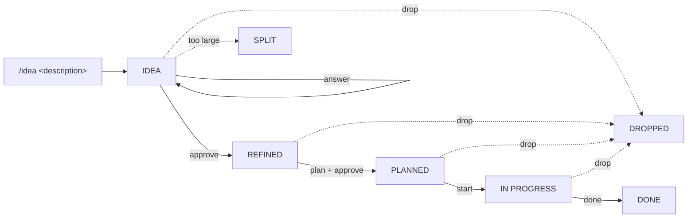

<div align="center">

# idea-to-done

**A Claude Code skill that takes an idea from first description to verified delivery, with a gate you approve at every step.**

[](https://code.claude.com)
[](LICENSE)


[Why](#why) · [Features](#features) · [Workflow](#workflow) · [Commands](#commands) · [Install](#install) · [Limitations](#limitations)

</div>

---

## Why

AI coding agents are fast at writing code. That speed is also the risk. Without a process, the same problems show up again and again:

| Problem | What happens |
|---|---|
| **Code before understanding** | A half-formed idea becomes code before anyone asks what problem it solves, for whom, or how to tell it worked. |
| **Silent scope creep** | The agent fills gaps on its own and builds more, or something else, than you meant. |
| **"Done" means "written"** | Nobody checks that the delivered change actually meets the requirements. |
| **Lost ideas** | An idea that comes up mid-task is either forgotten or started at once, and focus is lost. |
| **Vague approvals** | A casual "sounds good" in chat is read as permission to implement. |
| **Guesses presented as facts** | The agent describes code it never read as if it had inspected it. |

`/idea` fixes this with a simple order: **understand, plan, build, prove.**

## Features

- 🚦 **Explicit gates.** Status changes only through commands like `/idea approve 007`. A chat "ok" never counts, so you always know exactly what you approved.
- 🔒 **No code before an approved plan.** During intake the agent may read the codebase but writes only the backlog and plan documents.
- 🔗 **End-to-end traceability.** Questions (`Q1`), assumptions (`A1`) and acceptance criteria (`AC1`) get IDs. Every plan step names the criteria it satisfies, and `/idea done` verifies them one by one, with evidence.
- 🗣️ **Pushback built in.** The agent says so when an idea duplicates existing functionality, conflicts with the architecture or costs more than it returns. The decision stays yours.
- 🔍 **Honest about what was read.** Every brief lists the files that were inspected, and the ones that were not.
- ⏱️ **Stale-plan check.** `/idea start` uses `git log` to detect changes to affected files since the brief was written.
- 📥 **Capture without derailing.** Ideas that come up during other work become a two-line backlog file, and the current work continues.
- 🪶 **Light for small ideas.** A small idea gets a short brief, with `N/A` for sections that do not apply and no subagent.
- 🧠 **Context-friendly.** The full process loads only when you run `/idea`. Only four always-on rules live in your global configuration.

## Workflow



| Status | Meaning |
|---|---|
| `IDEA` | New or being refined |
| `REFINED` | Brief approved |
| `PLANNED` | Plan approved |
| `IN PROGRESS` | Being implemented |
| `DONE` | All acceptance criteria verified |
| `DROPPED` | Cancelled, reason recorded |
| `SPLIT` | Divided into smaller parts, each with its own backlog file |

### What a brief contains

1. **Problem:** what it solves, for whom, and how we know it worked
2. **Restated scope** in the agent's own words
3. **Open questions:** at most five, plus numbered assumptions you can correct
4. **Acceptance criteria:** observable conditions for "done"
5. **Out of scope**
6. **Edge cases and non-functional concerns:** errors, empty states, permissions, performance, security, privacy, backwards compatibility
7. **Impact analysis:** affected modules, files, data models and APIs, plus a list of inspected files
8. **Options:** only when there is a real choice, with a recommendation
9. **Risks and dependencies:** migrations, breaking changes, anything hard to undo
10. **Size:** a proposed split if the work cannot be delivered and verified as one unit

## Commands

| Command | Requires | Does |
|---|---|---|
| `/idea <description>` | – | Reads the code, creates a backlog file and writes the brief |
| `/idea answer NNN <answers>` | `IDEA` | Records your answers and updates the brief |
| `/idea approve NNN` | `IDEA` / `REFINED` | Approves the brief or the plan |
| `/idea plan NNN` | `REFINED` | Writes the implementation plan |
| `/idea start NNN` | `PLANNED` | Checks for stale files, then implements step by step |
| `/idea done NNN` | `IN PROGRESS` | Verifies every acceptance criterion |
| `/idea drop NNN <reason>` | any except `DONE` | Cancels the idea and records why |
| `/idea list` | – | Shows the backlog |

### Example

```text
/idea Users should be able to export their listings as CSV
```

Claude creates `docs/backlog/001-csv-export.md` with a full brief and stops. Then:

```text
/idea answer 001 Q1: own listings only, Q2: semicolon as separator
/idea approve 001
/idea plan 001
/idea approve 001
/idea start 001
/idea done 001
```

## Install

The skill installs globally and works in every project.

<details open>
<summary><b>macOS, Linux or Git Bash</b></summary>

```bash
git clone https://github.com/abmi55/idea-to-done.git
cp -r idea-to-done/skills/idea ~/.claude/skills/
mkdir -p ~/.claude/rules && cp idea-to-done/rules/idea-intake.md ~/.claude/rules/
```

</details>

<details>
<summary><b>Windows PowerShell</b></summary>

```powershell
git clone https://github.com/abmi55/idea-to-done.git
Copy-Item -Recurse idea-to-done\skills\idea $HOME\.claude\skills\
New-Item -ItemType Directory -Force $HOME\.claude\rules
Copy-Item idea-to-done\rules\idea-intake.md $HOME\.claude\rules\
```

</details>

Restart Claude Code and type `/idea` to see the help.

> [!TIP]
> If a project's `CLAUDE.md` already has its own idea rules, remove them so Claude does not get two conflicting versions.

## Repository layout

```text
skills/idea/
├── SKILL.md            modes, gates and rules
├── brief-template.md   the ten brief sections
├── plan-template.md    plan format with a coverage table
└── backlog-format.md   statuses and file format
rules/
└── idea-intake.md      always-on rules, active even without /idea
```

In each project, the skill creates:

```text
docs/backlog/NNN-name.md   brief, decisions, verification and history
docs/plans/NNN-name.md     implementation plan
```

## Limitations

> [!NOTE]
> The skill and the documents it writes are in **Swedish**. To use another language, edit the language line near the top of `skills/idea/SKILL.md`.

- "Do not write project files during intake" is an instruction, not a technical block. Claude follows it, but you can add a `PreToolUse` hook that blocks file edits outside `docs/` if you want a hard guarantee.
- The stale-plan check needs the project to be a git repository.
- The skill sets `disable-model-invocation: true`. Claude never starts it on its own, only you can, with `/idea`.

## License

[MIT](LICENSE) © 2026 Abbas Mirhazar
